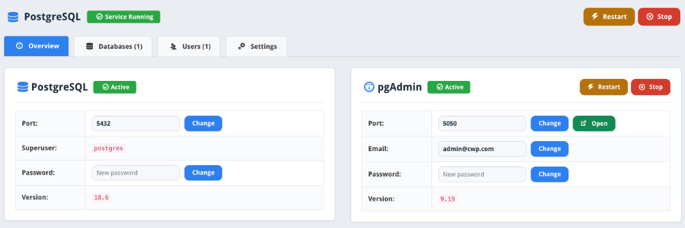

# PostgreSQL & pgAdmin Module for Control Web Panel (CWP)

PostgreSQL and pgAdmin 4 management module for [Control Web Panel (CWP)](https://control-webpanel.com/).

---



---

## Features

- PostgreSQL and pgAdmin 4 installation on CWP
- Start, stop, and restart services
- Create and delete databases
- Create users and update passwords
- Manage ports and pgAdmin credentials
- Edit configuration file

---

## Installation

Run on your CWP server as `root`:

```bash
curl -fsSL https://raw.githubusercontent.com/QadirAdamson/CWP-Module-PostgreSQL-pgAdmin/main/install.sh | bash
```

Access in CWP Admin Panel: **SQL Services → PostgreSQL / pgAdmin**

---

## Uninstallation

Run on your CWP server as `root`:

```bash
curl -fsSL https://raw.githubusercontent.com/QadirAdamson/CWP-Module-PostgreSQL-pgAdmin/main/uninstall.sh | bash
```

---

## License

MIT License
